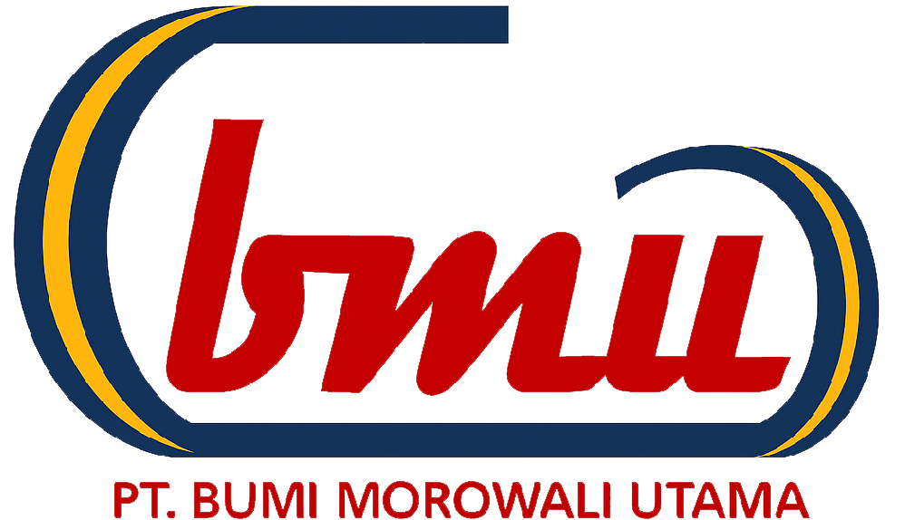

<div align="center">
  
  <h1>PT Bumi Morowali Utama</h1>
  <p>Website perusahaan pertambangan nikel di Morowali, Sulawesi Tengah.</p>
  <p><a href="https://bumimorowaliutama.com/id">Website Resmi</a> · <a href="https://bumimorowaliutama.com/en">English</a> · <a href="https://bumimorowaliutama.com/zh">中文</a></p>
</div>

---

## Tentang project

Repository ini berisi frontend website **PT Bumi Morowali Utama (PT BMU)** untuk menyajikan profil perusahaan, kegiatan eksplorasi dan operasi pertambangan, portofolio, berita, karir, serta informasi kontak.

Aplikasi menggunakan Next.js App Router dengan tiga bahasa dan tema terang/gelap. Frontend berjalan di Vercel, sedangkan layanan API dikelola secara terpisah dari repository ini.

## Fitur

- **Multibahasa:** Indonesia (`/id`), Inggris (`/en`), dan Mandarin (`/zh`).
- **Desain responsif** dengan dukungan light mode dan dark mode.
- **Profil dan kegiatan perusahaan:** eksplorasi, operasi, portofolio, serta prospek industri nikel.
- **Berita dan formulir kontak** melalui integrasi API, serta halaman karir yang mengarahkan pengunjung ke portal rekrutmen.
- **SEO:** metadata per halaman, canonical, hreflang, Open Graph, dan data terstruktur Organization/WebSite.
- **Sitemap dan robots.txt** untuk membantu penemuan halaman oleh mesin pencari.
- **Sanitasi HTML artikel dan security headers** sebagai bagian dari perlindungan frontend.

## Teknologi

| Bagian | Teknologi |
| --- | --- |
| Framework | Next.js 15 · App Router |
| Antarmuka | React 19 · TypeScript |
| Styling | Tailwind CSS 4 · CSS |
| Internasionalisasi | next-intl |
| Tema | next-themes |
| Animasi dan ikon | Framer Motion · Lucide React |
| Sanitasi konten | sanitize-html |
| Deployment frontend | Vercel |

Versi dependensi tersedia di [package.json](package.json) dan dikunci melalui [package-lock.json](package-lock.json).

## Menjalankan secara lokal

Siapkan Git, Node.js, dan npm yang kompatibel dengan dependensi project.

### 1. Clone dan instal dependensi

```bash
git clone https://github.com/robyfirmansya11/bmu-company-frontend.git
cd bmu-company-frontend
npm ci
```

### 2. Konfigurasi environment

Buat file `.env.local` di root project:

```dotenv
SITE_URL=https://bumimorowaliutama.com
NEXT_PUBLIC_API_URL=http://127.0.0.1:8000
NEXT_PUBLIC_APP_URL=http://127.0.0.1:8000
```

| Variabel | Kegunaan |
| --- | --- |
| `SITE_URL` | Domain utama untuk canonical, sitemap, dan data terstruktur. Default: `https://bumimorowaliutama.com`. |
| `NEXT_PUBLIC_API_URL` | Alamat dasar backend tanpa akhiran `/`, diperlukan untuk fitur berbasis API. |
| `NEXT_PUBLIC_APP_URL` | Alamat dasar server media ketika API mengembalikan path gambar berita relatif. |
| `GOOGLE_SITE_VERIFICATION` | Opsional: token verifikasi HTML Google Search Console. Tidak diperlukan untuk verifikasi DNS TXT. |

Alamat localhost di atas merupakan contoh pengembangan. Sesuaikan dengan backend dan server media yang digunakan. Variabel berawalan `NEXT_PUBLIC_` dapat terlihat di browser; jangan gunakan untuk menyimpan rahasia. File environment lokal diabaikan oleh Git.

### 3. Jalankan aplikasi

```bash
npm run dev
```

Buka [http://localhost:3000/id](http://localhost:3000/id). Bahasa lain tersedia pada `/en` dan `/zh`.

Untuk menggunakan port berbeda:

```bash
npm run dev -- --port 3003
```

Halaman profil statis dapat digunakan tanpa backend. Data berita, detail lowongan, dan pengiriman formulir kontak memerlukan backend serta konfigurasi yang sesuai. Repository ini tidak menyediakan server API atau database.

## Build produksi

Hentikan development server pada folder project yang sama sebelum menjalankan build.

```bash
npm run build
npm run start
```

## Pemeriksaan

Pemeriksaan tipe dan pengujian otomatis:

```bash
npx tsc --noEmit
node --test tests/i18n.test.cjs tests/scroll-up.test.cjs tests/security.test.cjs
```

Untuk memeriksa halaman dan HTML SEO, jalankan server terlebih dahulu. Contoh PowerShell:

```powershell
$env:BMU_PREVIEW_URL = "http://127.0.0.1:3000"
node tests/i18n-smoke.cjs
node tests/seo-smoke.cjs
```

Pengujian mencakup konsistensi terjemahan, navigasi bahasa, respons halaman, sanitasi artikel, security headers, serta keluaran metadata, sitemap, dan data terstruktur. Tes SEO saat ini mengharapkan canonical domain `https://bumimorowaliutama.com`.

## Struktur repository

```text
src/
├── app/                # Route, layout, sitemap, dan robots
│   └── [locale]/       # Halaman berbahasa id, en, dan zh
├── components/         # Komponen antarmuka
├── lib/                # API, locale, metadata, SEO, dan sanitasi
├── messages/           # Kamus terjemahan JSON
├── services/           # Integrasi layanan
├── styles/             # Stylesheet tambahan
└── middleware.ts       # Penanganan locale
public/                 # Logo, foto, dan aset statis
tests/                  # Pengujian otomatis dan smoke test
docs/                   # Dokumentasi bahasa, SEO, dan keamanan
```

## Deployment

Repository terhubung dengan Vercel untuk deployment otomatis dari branch `main`.

1. Pastikan pemeriksaan yang relevan berhasil sebelum push.
2. Atur environment produksi di Vercel, termasuk alamat backend yang dapat diakses publik.
3. Push perubahan ke `main`, kemudian periksa hasil build dan deployment di Vercel.
4. Periksa halaman utama, navigasi bahasa, formulir kontak, `/robots.txt`, dan `/sitemap.xml` setelah deployment.

Domain dikelola melalui Rumahweb, sedangkan frontend berjalan di Vercel. Pertahankan pengaturan DNS email saat mengubah konfigurasi domain website.

## SEO dan dokumentasi

Identitas perusahaan menggunakan nama **PT Bumi Morowali Utama**, dengan variasi **PT BMU**, **Bumi Morowali Utama**, dan **BMU**.

- [Panduan SEO dan Google Search Console](docs/seo.md)
- [Dokumentasi bahasa](docs/languages.md)
- [Catatan pemeriksaan keamanan](docs/security-review.md)
- [Sitemap produksi](https://bumimorowaliutama.com/sitemap.xml)

Sitemap mencakup halaman publik statis dalam tiga bahasa. Halaman legalitas dan dokumen unduhannya telah dihapus dari versi saat ini. SEO membantu mesin pencari memahami website, tetapi tidak menjamin waktu pengindeksan atau posisi tertentu dalam hasil pencarian.

## Lisensi dan atribusi

Project dikembangkan dari template **Startup** oleh **Next.js Templates**. Atribusi dan ketentuan lisensi sumber tersedia dalam [LICENSE](LICENSE).

Logo, foto, dan materi perusahaan digunakan sebagai identitas serta konten website PT Bumi Morowali Utama. Penggunaan ulang materi tersebut perlu memperhatikan hak pemiliknya.
